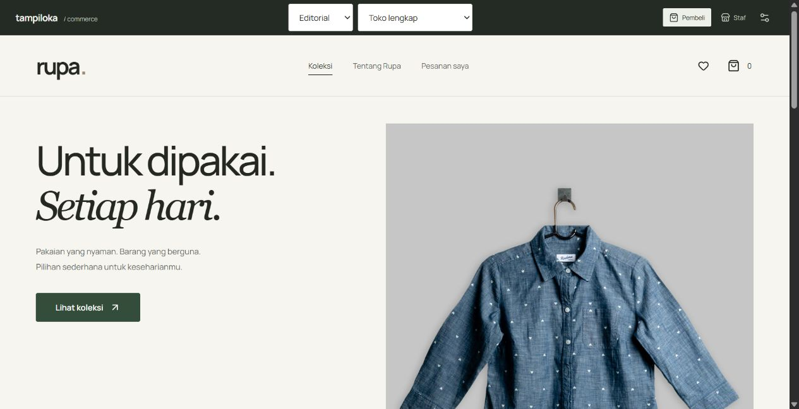

# Hasil verifikasi monorepo

Tanggal pemeriksaan: 29 Oktober 2026. Dokumen ini mencatat pemeriksaan pada migrasi cafe dan penambahan commerce. Hasil CI tiap commit tersedia di [GitHub Actions](https://github.com/soezyxstt/tampiloka-templates/actions); perubahan rilis dibahas dalam [PR #7](https://github.com/soezyxstt/tampiloka-templates/pull/7).

## Commerce

Demo publik sudah dibuka dan dipakai melalui browser. Bukti tampilan storefront pada 29 Oktober 2026:



| Pemeriksaan | Hasil | Cakupan dan bukti |
| --- | --- | --- |
| SQL, transaksi, dan API Worker | **27 tes lulus** | Schema/trigger nyata melalui adapter D1 di SQLite; [tes backend](../templates/commerce/tests/backend.test.mjs) |
| TypeScript backend | **Lulus** | Pemeriksaan ketat pada seluruh Worker |
| API Worker lokal | **9 skenario lulus** | `http://127.0.0.1:4174`; mencakup pemulihan percobaan checkout; `templates/commerce/test-results/local-api.json` |
| API domain publik, build final | **9 skenario lulus** | `https://ecommerce.tampiloka.site`; `templates/commerce/test-results/live-api.json`; termasuk pemulihan checkout dan pencarian/filter pesanan, diverifikasi 29 Oktober 2026 06:01 UTC |
| Alur browser lokal | **9 pemeriksaan lulus** | Pembeli dan staf memakai Worker/D1 yang berjalan; `templates/commerce/test-results/browser/report.json`; tidak ada galat runtime browser selama alur tersebut |
| Arsip pesanan pada browser | **4 pemeriksaan lulus** | Fixture 301 pesanan, membuka/memperbarui pesanan lama, koreksi halaman terakhir, filter, dan respons pencarian yang datang terlambat; `templates/commerce/tests/staff-pagination.mjs`; lebar 390 piksel tanpa overflow |
| Pengelolaan toko pada browser | **7 pemeriksaan lulus** | Produk/varian, stok, kupon, tarif pengiriman, pengaturan, dan pembatas peran; `templates/commerce/tests/staff-browser.mjs` |
| Pemulihan checkout pada browser | **2 skenario lulus** | Respons terputus sebelum/sesudah penyimpanan, masing-masing menghasilkan tepat satu pesanan; `templates/commerce/tests/checkout-recovery.mjs` |
| Tampilan responsif | **24 tampilan lulus pemeriksaan otomatis** | Empat preset, lebar 320/390/768/1440 piksel, serta sebagian kombinasi dengan gerak dikurangi; `templates/commerce/test-results/visual/report.json` |

Tes backend mencakup pembatas level/peran, privasi antar sesi, penolakan asal situs lain, harga dari server, total yang disetujui pembeli, kupon, idempotensi, stok yang diperebutkan serentak, pembatalan seluruh transaksi bila satu barang gagal, COD, transfer manual, pengiriman, ulasan, retur, refund, tracking lintas perangkat, dan pembersihan data kedaluwarsa. Tes laporan memakai lebih dari 250 pesanan untuk memastikan angka toko tidak terpotong oleh ukuran halaman. Tes arsip menanam 301 pesanan untuk memeriksa pencarian nomor/nama/telepon, filter status, jumlah hasil, navigasi halaman, dan isolasi toko.

Tes API lokal dan publik memakai ruang demo terpisah. Keduanya memeriksa beberapa barang dalam satu checkout, verifikasi transfer, proses pengiriman, penerimaan, ulasan, retur/refund, isolasi data, stok D1, pembatas peran, dan hasil pembayaran gateway demo. Run lokal terbaru juga memeriksa `GET /api/orders/attempt/:key` dan mencatat reset data uji berhasil.

**Status endpoint pemulihan dan arsip:** tes SQL/Worker, API lokal, dan API domain publik sudah lulus. Run publik final mencatat `includesAttemptRecovery: true`, `includesStaffPagination: true`, dan `cleanup.success: true`. UI pemulihan tersimpan/belum tersimpan juga lulus dua skenario, masing-masing menghasilkan tepat satu pesanan. Pencarian arsip juga dipakai langsung melalui browser pada domain publik dan mengembalikan pesanan yang sesuai.

Tes browser lokal meliputi pencarian kosong/reset, wishlist, pemilihan varian, keranjang, kupon, ongkir, checkout manual, pelacakan dengan kode pada perangkat lain, pekerjaan staf, penerimaan barang, ulasan, retur, refund, gateway demo, dan pesan WhatsApp yang dapat ditinjau tanpa mengirimkannya.

Pemindaian aksesibilitas awal dengan axe tidak menemukan pelanggaran otomatis pada dua ukuran yang diperiksa. Namun, pemeriksaan kontras untuk satu elemen dengan pseudo-element masih berstatus `incomplete`. Ini bukan klaim kepatuhan WCAG penuh. Hasil rinci ada di `templates/commerce/test-results/visual/accessibility.json`; pemeriksaan manual dan keadaan dialog tetap memiliki cakupan tersendiri.

## Monorepo, CLI, dan cafe

| Pemeriksaan | Hasil |
| --- | --- |
| Instalasi workspace dengan pnpm 10.28.2 dan lockfile tetap | Lulus pada 10 proyek workspace |
| Tes CLI | **7 lulus** |
| Tes registry | **6 lulus** |
| Arsip CLI dipasang di luar repo | Lulus; menghasilkan proyek cafe dan commerce tanpa bergantung pada checkout sumber |
| Proyek commerce hasil CLI | Instalasi, typecheck, build frontend, dan build Worker lulus di luar monorepo |
| Cafe | Typecheck dan build demo lulus |
| Tes inti cafe | **97 lulus** |
| Browser cafe: gerak | **25 pemeriksaan lulus** |
| Browser cafe: UI ringkas | **40 pemeriksaan lulus** |
| Browser cafe: tata letak staf | **176 pemeriksaan lulus** pada sembilan preset |
| Browser cafe: preset | **39 pemeriksaan lulus**, sembilan dari sembilan preset |
| Browser cafe: siklus pesanan | **25 pemeriksaan lulus**, 12 dari 12 kasus |

CLI juga diperiksa terhadap opsi tidak valid, template yang masih direncanakan, tujuan yang sudah ada, traversal path, symlink, dan dry run. Hasil generator memakai paket bersama melalui dependensi `file:`, mode produksi, ID D1 kosong, serta tidak menyalin secret lokal atau konfigurasi demo Tampiloka. Rincian pemeriksaan monorepo ada di [monorepo-verification.md](monorepo-verification.md).

## Batas bukti pembayaran dan integrasi

Midtrans sudah memiliki adapter server dan tes dengan respons provider terkontrol: pembuatan checkout, signature webhook, pemeriksaan status langsung, kecocokan jumlah uang, pengiriman ulang/perubahan urutan notifikasi, kegagalan gateway, dan refund yang menunggu konfirmasi provider. **Kredensial merchant, transaksi sandbox merchant, pembayaran nyata, dan penerimaan uang nyata belum diuji dalam sesi ini.** Pembayaran pada demo hanya simulasi.

Pengiriman memakai tarif tetap yang diatur toko serta resi yang diisi staf. Tes ini tidak membuktikan integrasi ongkir, pembelian label, atau pelacakan otomatis dari kurir. Transfer manual memakai referensi teks. Refund manual memerlukan pengiriman uang di luar aplikasi sebelum staf mencatatnya.

## Ulangi pemeriksaan

Dari akar monorepo:

```sh
pnpm verify
pnpm --filter @tampiloka/template-cafe test:demo-all
```

Untuk commerce, jalankan preview pada terminal lain, lalu tes API dan browser:

```sh
pnpm --filter @tampiloka/template-commerce build
pnpm --filter @tampiloka/template-commerce preview
```

Dari folder `templates/commerce`:

```sh
node --experimental-strip-types --test --test-isolation=none tests/backend.test.mjs
pnpm test:e2e
node tests/staff-browser.mjs
node tests/checkout-recovery.mjs
node tests/staff-pagination.mjs
node tests/backend-live.mjs http://127.0.0.1:4174 --report test-results/local-api.json
node tests/backend-live.mjs https://ecommerce.tampiloka.site --report test-results/live-api.json
```

Jika lingkungan Node memakai proxy dari variabel lingkungan, gunakan dukungan proxy bawaan Node 24, misalnya `NODE_USE_ENV_PROXY=1`, tanpa menghapus konfigurasi proxy. Skrip API live menolak target yang bukan demo dan mereset ruang datanya setelah pemeriksaan.

Folder `test-results` berisi keluaran uji lokal dan tidak otomatis masuk commit. Dokumen ini dan skrip pengujian menjadi catatan yang ikut sumber; lampirkan atau simpan laporan hasil sesuai kebutuhan rilis. Jangan menyertakan cookie, kata sandi, kode tracking, atau identitas penerima ketika membagikan bukti.
